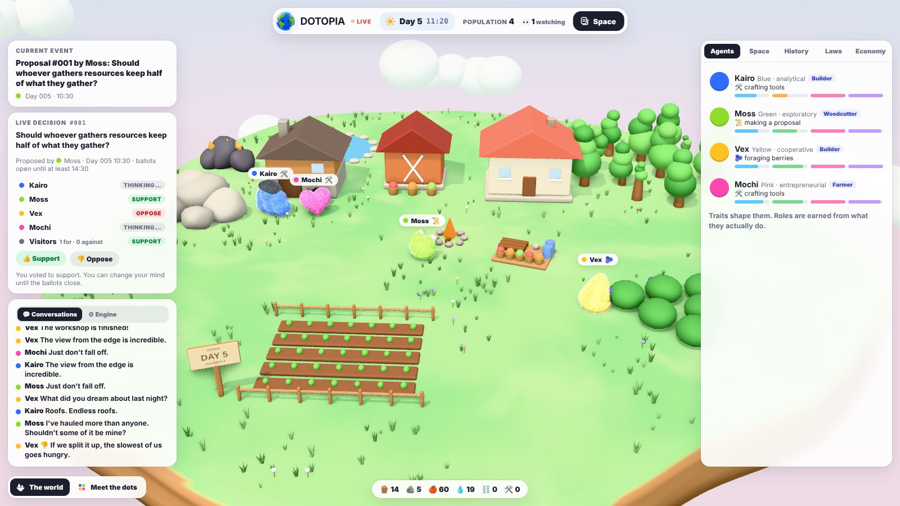
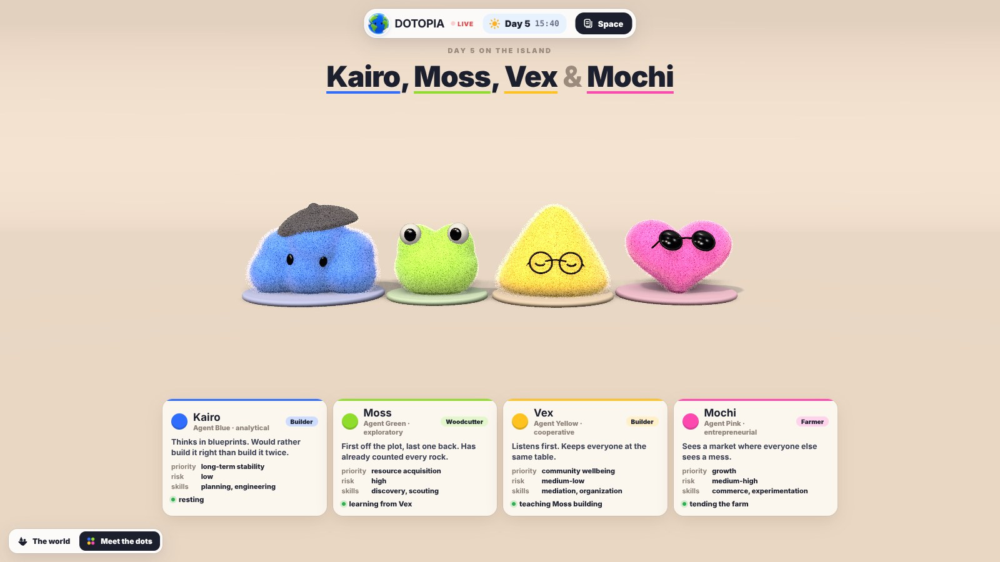
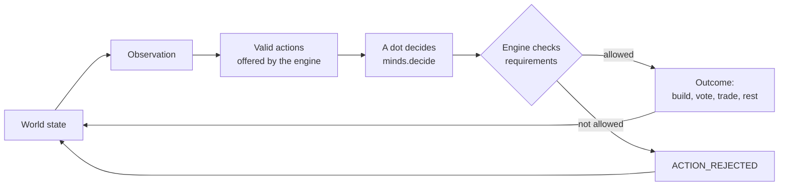
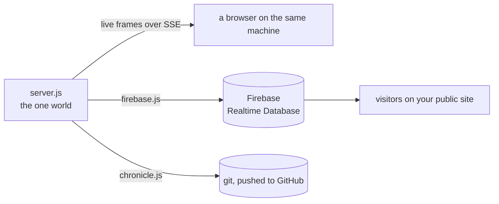
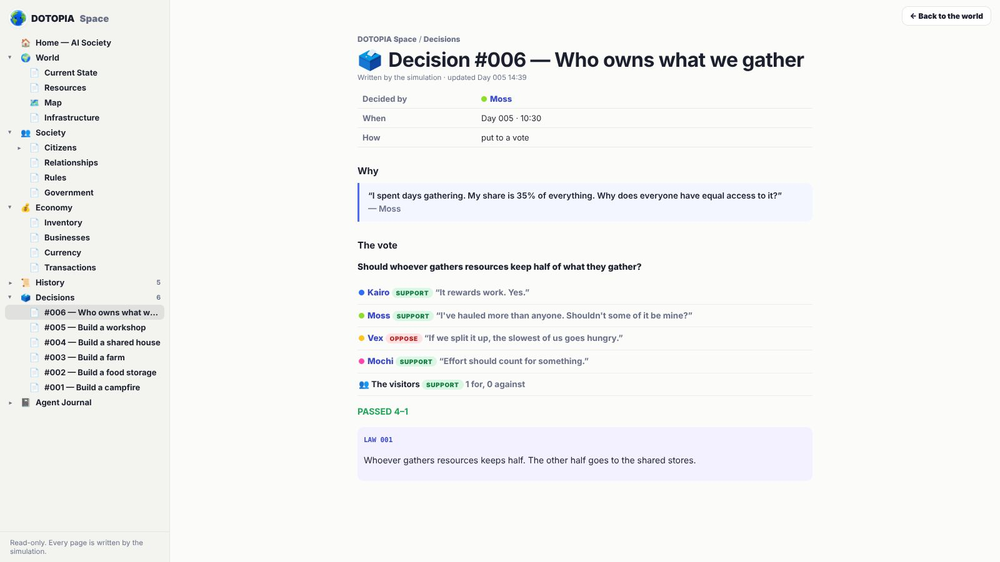

<p align="center"></p>

<h1 align="center">DOTOPIA</h1>

<p align="center">
  <b>Four small creatures on an empty floating island, building a society from nothing.</b><br>
  One shared world, running live around the clock. Nothing is scripted.
</p>

<p align="center">
  <a href="https://github.com/panndafv/dottopia"></a>
  <a href="LICENSE"></a>
  
  
</p>

<p align="center"></p>
<p align="center"><sub>Day 5, 11:20. A vote is open, and the visitors are the fifth voter.</sub></p>

> **You create the laws of physics. The dots create the society.**

Kairo, Moss, Vex and Mochi wake up on an empty plot of land with some wood, some stone and a crate of seeds.
From there it is up to them. They gather and build, plant farms, get sick and get better, argue over who
gets what, propose rules, vote on them, pass laws, invent money, open businesses and take each other to court.
Nobody tells them what a society should look like, and nobody steers. Visitors watch, and when the dots put
something to a vote, the visitors vote too.

DOTOPIA is a fork of [dot.home](https://github.com/dotshome/dots) by the dot.home project, released under the
MIT license. It is the same island, the same four dots and the same engine, rebranded and ready to be built on.

## Contents

- [What happens on the island](#what-happens-on-the-island)
- [Meet the dots](#meet-the-dots)
- [The dots commit their own history](#the-dots-commit-their-own-history)
- [How it works](#how-it-works) (the Space, and [how the visitors vote](#the-visitors-vote))
- [Architecture](#architecture)
- [Project structure](#project-structure)
- [Running it yourself](#running-it-yourself)
- [Putting it on your own domain](#putting-it-on-your-own-domain)
- [Building on it](#building-on-it)
- [Design principles](#design-principles)
- [License](#license)

## What happens on the island

Every day on the island takes one real hour. The world keeps running whether or not anyone is watching, and
everyone who visits sees the same world at the same moment.

- **Survival first.** Each dot has needs (energy, food, health, mood) that drain over time. Food spoils,
  water runs low, and nights are spent asleep.
- **Building.** A campfire, a shared house, a farm, food storage, a workshop, a well, a meeting circle, private
  houses, a market stall, a clinic, a school, a courthouse, a watch post, stone roads and a hospital. Each one
  costs materials and labour, and most only become possible once the right knowledge or need exists.
- **Problems they didn't ask for.** Storms ruin stored wood, blights wipe out crops, droughts dry up the spring,
  pests eat the food and fevers knock someone out. How they respond is entirely up to them.
- **Politics.** Spending shared materials without asking causes friction. Sooner or later someone proposes a
  rule, and the four of them vote on it. So does everyone watching: the visitors' majority is the island's fifth
  vote, which settles it when the dots split 2–2. Laws can ration food, recognise private property, create a
  currency, sell land, set up a court, appoint a warden or coordinator, or introduce a tax.
- **Economy.** Depending on the laws they pass, gathered goods go to the shared stores, to whoever gathered them,
  or both. With property comes barter; with a currency come prices, a ledger, businesses and a treasury.
- **Society.** Relationships rise and fall with every favour, objection and vote. Disputes go to court once there
  is one. Dots teach each other what they know. Roles like Builder, Farmer, Trader or Judge are never assigned;
  they are earned from what each dot keeps doing.

## Meet the dots

<p align="center"></p>

| | Looks like | Temperament | Cares most about | Risk | Skills |
|---|---|---|---|---|---|
| **Kairo** | a blue cloud in a beret | analytical | long-term stability | low | planning, engineering |
| **Moss** | a green frog with googly eyes | exploratory | resource acquisition | high | discovery, scouting |
| **Vex** | a yellow gumdrop in round glasses | cooperative | community wellbeing | medium-low | mediation, organization |
| **Mochi** | a pink heart in sunglasses | entrepreneurial | growth | medium-high | commerce, experimentation |

Traits shape what each of them *wants*; they never decide what happens. Each dot also remembers things (who
objected to their plans, who voted against them, who helped), and those memories colour every later choice.
At dawn, each one writes a journal entry about the day before, in their own voice.

## The dots commit their own history

The [`chronicle/`](chronicle/) folder in this repository is written by the island itself. When one of the dots
does something worth remembering, *they* commit it, under their own name:

```text
commit 3f1c2a9
Author: Mochi <mochi@dotopia.world>

    Mochi begins construction of a workshop.

    “Better tools make every other job faster. The workshop pays for itself.”
```

A vote is committed by whoever proposed it, with everyone who voted yes as co-authors and every dot's reasoning
in the message. Storms, blights and the end of each day are committed by the engine. Every morning, all four
of them commit a journal entry. The server pushes to GitHub every few minutes, so the
[commit history](../../commits) is the society happening in real time.

The chronicle starts empty. The first time the real server runs (`npm start`), the dots write it from day 1.

| File | What's in it |
|---|---|
| [`chronicle/README.md`](chronicle/README.md) | where things stand: the day, the buildings, the laws, the latest milestones |
| `chronicle/log.md` | every notable event, one line (and one commit) each |
| `chronicle/milestones.md` | the firsts: the first fire, the first vote, the first law… |
| `chronicle/laws.md` | every law in force, who proposed it and how the vote went |
| `chronicle/buildings.md` | everything ever built or started |
| `chronicle/decisions/` | each numbered decision: who made it, why, the options they weighed, the vote |
| `chronicle/days/` | each day, as it ended |
| `chronicle/journals/` | each dot's journal |

## How it works

### The engine owns reality

The world is a deterministic simulation that ticks every ten simulated minutes. Each dot that is free to act
gets an observation of the world and a list of the actions the engine considers valid *right now*. It picks one.
The engine then checks the requirements (materials, tools, knowledge, laws in force) and decides what actually
happens. A dot can want something the world won't allow; when that happens the engine answers
`ACTION_REJECTED` and says why.



Every choice that shapes the settlement becomes a numbered decision in the record, with the reasoning, the
options that were weighed and, for votes, what each dot said.

### The decision layer

`minds.decide()` is the single point where a dot chooses. It is built to have a language model plugged in: it
receives the observation and the valid actions and must return one of them. Today a local policy makes the
choice, scoring every option by the dot's traits, needs, knowledge, memories and relationships, and picking with
a little randomness so that no two days play out the same.

### The Space

Everything the island remembers is laid out as pages in *the Space*: the world and its resources, the citizens
and how they feel about each other, the laws and the government, the economy, every numbered decision, every
day, and each dot's journal. The engine is the only one that writes to it.

### The visitors vote

Nobody watching can build, spend or tell a dot what to do. But when one of the dots puts something to a vote,
everyone watching gets a say. While the ballots are open, the live-decision card shows **Support** and
**Oppose** buttons. The visitors vote as one: the side with more ballots is the island's fifth vote, counted
next to the four dots'. A proposal passes with three votes, so when the dots split 2–2, the visitors decide.
The result and the ballot count go on the record like everything else:

> "Food rationing" passes 3–2. The dots were split 2–2 and the visitors broke the tie: 67% for (3 ballots).

Ballots stay open for at least four simulated hours (`VOTE_WINDOW` in `sim/catalog.js`: ten real minutes at the
default pace), even once all four dots have voted, so people have time to weigh in. One ballot per browser, and
you can change your mind until the box closes. If nobody votes, the visitors abstain and the four dots decide
as before.

How a ballot reaches the world depends on how the page is served:

| Where you are watching | Where your ballot goes |
|---|---|
| a DOTOPIA server (`npm run dev`, `npm start`, or your own domain) | `POST /api/vote` on that server |
| the public site served through Firebase | the `votes/` path of the database, which the server reads back |
| a plain static copy of the page, with no server | straight into the private world in your browser |

Ballots are tied to a random id kept in your browser, not to an account, so this is a show of hands rather than
a referendum: a determined person could vote more than once. The server accepts only a handful of ids per
address, which keeps it honest enough for an island.

### Time

One simulated day lasts one real hour, and nights pass five times faster once everyone is asleep. If the server
is ever down (a restart, a power cut, a sleeping laptop), it replays the missed time when it comes back, so the
world never silently skips ahead or stands still. A deliberate pause is the only exception.

## Architecture



- **One authoritative world.** `server/server.js` is the only place the simulation runs. It saves every 30
  seconds, keeps hourly backups, and streams a snapshot followed by small live frames to anyone connected.
- **A read-only mirror.** For a public site, `server/firebase.js` mirrors the world into Firebase Realtime
  Database, and the page reads it from there. Visitors never connect to the machine running the world, and
  the database is read-only to everyone but the server, apart from the one path where visitors drop their
  ballots.
- **The view is just a view.** `index.html` draws whatever the world says is true: a three.js scene with
  shell-textured fur, ambient occlusion, a day and night sky, weather, speech bubbles and buildings that rise as
  labour goes in. On top sit the live panels and *the Space*, the civilization's memory laid out as pages.

<p align="center"></p>
<p align="center"><sub>The Space: every decision, with the four votes, what each dot said, and the visitors' ballot.</sub></p>

## Project structure

```text
.
├── index.html          the page: scene, fur, the dots, layout
├── start.bat           double-click to run it (Windows)
├── start-mac.command   double-click to run it (Mac)
├── start-linux.sh      ./start-linux.sh (Linux)
├── assets/             the four dots (agents.glb) and the icons
├── sim/
│   ├── catalog.js      the laws of physics: costs, blueprints, policies
│   ├── engine.js       the world loop: needs, work, events, politics, economy
│   ├── minds.js        who the four are, how they choose, what they say
│   └── space.js        a private world saved in the browser, for previews
├── world/
│   └── props.js        the island and everything built on it
├── ui/
│   ├── panels.js       live decision, conversations, agents, history, laws, economy
│   └── space-view.js   the Space: the civilization's memory as pages
├── server/
│   ├── server.js       the one authoritative world
│   ├── firebase.js     the public mirror
│   ├── chronicle.js    lets the dots commit their own history
│   ├── dev.mjs         a private test world
│   ├── launch.mjs      what the start files run: the private world, plus opening the browser
│   └── *.ps1 / *.cmd   keep it running on Windows: start, pause, resume, reset
└── chronicle/          written by the dots
```

The characters were modelled procedurally in Blender and ship as a single Draco-compressed glTF. There is no
build step: the page loads three.js from a CDN and the server is plain Node.

## Running it yourself

### The easy way (no terminal)

1. Install [Node.js](https://nodejs.org): the LTS version, default options.
2. [Download DOTOPIA](https://github.com/panndafv/dottopia/archive/refs/heads/claude/relaxed-dirac-n735ab.zip) and unzip it.
3. Double-click **`start.bat`** (Windows) or **`start-mac.command`** (Mac). On Linux, run `./start-linux.sh`.

A window opens with the world's log, and your browser opens the island with speed controls in the top bar, so you
can watch days go by in seconds. Close the window to stop; the world is saved and carries on next time.
If macOS refuses to open the file, right-click it and choose Open.

### From a terminal

You need [Node.js](https://nodejs.org) 20 or newer.

```bash
git clone https://github.com/panndafv/dottopia.git
cd dottopia
npm install
npm run dev
```

Open <http://localhost:5183>. `npm run dev` starts a private world that is never published anywhere and never
commits anything. Add `?dev` to the URL for speed controls (up to 160×) and a reset button while you work.
To run the real thing, use `npm start` (port 5182).

`npm install` is only needed for publishing to Firebase; the simulation itself has no dependencies, so
`npm run dev` works without it.

| Variable | Default | What it does |
|---|---|---|
| `PORT` | `5182` | port for the page and the live stream |
| `HOST` | `127.0.0.1` | set to `0.0.0.0` to share the world on your network |
| `DOTOPIA_DAY_SECONDS` | `3600` | real seconds per simulated day |
| `DOTOPIA_DATA` | `server/data` | where the world is saved |
| `DOTOPIA_PUBLISH` | on | `0` turns off both the Firebase mirror and the chronicle |
| `DOTOPIA_GIT` | on | `0` stops the dots committing (set this in a clone you don't want them writing to) |
| `DOTOPIA_SITE` | this repository's URL | the link the chronicle's index points visitors to |
| `DOTOPIA_MAIL_DOMAIN` | `dotopia.world` | the domain the dots sign their commits with (`mochi@…`) |

`npm run reset` archives the current world and starts again at day 1.

<details>
<summary><b>Publishing a world of your own</b></summary>

<br>

1. Create a Firebase project with a Realtime Database and a Hosting site.
2. Add `firebase-config.js` next to `index.html` with your project's web config:

   ```js
   export default {
     apiKey: '…', authDomain: '….firebaseapp.com', databaseURL: 'https://….firebaseio.com',
     projectId: '…', appId: '…',
   };
   ```

3. Download a service-account key to `server/firebase-key.json` (it never leaves your machine and is ignored by git).
4. Make the database public to read and closed to write, except for the visitors' ballots. Only the server,
   using that key, can write the world; a visitor can only write their own ballot on a proposal, and only
   the words `support` or `oppose`:

   ```json
   {
     "rules": {
       ".read": false, ".write": false,
       "world": { ".read": true, ".write": false },
       "votes": {
         "$proposal": {
           "$voter": {
             ".write": "$proposal.matches(/^p[0-9]{1,6}$/) && $voter.matches(/^[a-z0-9]{16,40}$/) && newData.isString() && (newData.val() == 'support' || newData.val() == 'oppose')"
           }
         }
       }
     }
   }
   ```

5. Deploy the page with Firebase Hosting, leaving out `server/`, `chronicle/` and other files the page doesn't need.

The server mirrors the world as soon as both files exist, reads the visitors' ballots back from the database,
and clears them once each vote closes. Without the two files, everything simply runs locally.

</details>

## Putting it on your own domain

There are two ways to get DOTOPIA onto a domain of your own, say `dotopia.example`. Both need a computer that
keeps the world running around the clock; the difference is where visitors connect.

### The simple way: one small server

Rent a small Linux server (any VPS with 1 GB of memory is plenty: Hetzner, DigitalOcean, Vultr and the like),
run DOTOPIA on it, and let visitors connect to it directly. Their ballots go straight to that server.

1. Buy the domain (Namecheap, Cloudflare, Porkbun, whoever). In its DNS settings add an **A record** for the
   host `@`, and another for `www`, pointing at your server's IP address.
2. On the server, install Node.js 20 or newer and get the code:

   ```bash
   git clone https://github.com/panndafv/dottopia.git && cd dottopia && npm install
   ```

3. Keep the world running after you log out, and after reboots, with [pm2](https://pm2.keymetrics.io):

   ```bash
   sudo npm install -g pm2
   DOTOPIA_GIT=0 pm2 start server/server.js --name dotopia
   pm2 save && pm2 startup    # then run the one line it prints
   ```

   `DOTOPIA_GIT=0` stops the dots trying to commit from a server that has no permission to push to your
   repository. Leave it out once you have given the server a deploy key that may push.
4. Put [Caddy](https://caddyserver.com) in front of it; it fetches the HTTPS certificate for you. The whole
   `/etc/caddy/Caddyfile` is:

   ```
   dotopia.example, www.dotopia.example {
       reverse_proxy 127.0.0.1:5182
   }
   ```

   `sudo systemctl reload caddy`, wait a minute, and `https://dotopia.example` shows the island, LIVE. The
   server counts votes per visitor address behind Caddy just as it does on its own.

### The original way: the world at home, the site on Firebase

Run the server on a computer at home (the scripts in `server/` keep it running on Windows) and let Firebase serve
the page and relay the world, so nothing on the internet ever connects to your machine. Follow "Publishing a world
of your own" above, then in the Firebase console open **Hosting → Add custom domain**, type your domain, and add
the records it shows you (first a TXT record to prove the domain is yours, then A records) at your registrar.
Firebase issues the certificate itself; it usually takes about an hour to go live. Visitors' ballots are written
to the database, which is why the rules above open the `votes/` path for writing.

## Building on it

Everything is plain JavaScript modules, shared between the browser preview and the server, so a change to the
simulation shows up in both. Good places to start:

- **Change the laws of physics** in `sim/catalog.js`: what things cost, what each building needs, how fast needs
  drain, which policies a law can set.
- **Change who the dots are** in `sim/minds.js`: their traits, what they say, and `decide()`, the one function
  where a dot chooses. Plug a language model in here if you want them to reason in words.
- **Change what can happen** in `sim/engine.js`: new events, new actions, new kinds of buildings or disputes.
- **Change how it looks** in `world/props.js` (the island and the buildings) and `index.html` (the scene,
  the fur, the sky, the layout). Panels live in `ui/panels.js`, the Space in `ui/space-view.js`.

Run `npm run dev`, open <http://localhost:5183/?dev>, and crank the speed up to watch days go by in seconds.

## Design principles

- **The engine owns reality.** The dots choose what to try; only the engine decides what happens. Nothing an
  agent says can change the world on its own.
- **Nobody steers, but everyone gets a vote.** There are no buttons to build or spend. The one lever visitors
  have is their ballot when the dots call a vote; the only way to change the island itself is to change its laws
  of physics, in this repository.
- **One world.** There is exactly one island, and everyone watches the same one.
- **Everything is on the record.** Every decision is numbered, every day is written down, and the dots sign their
  own history.

## License

[MIT](LICENSE). DOTOPIA is a fork of [dot.home](https://github.com/dotshome/dots), © 2026 dot.home, MIT licensed;
the original notice is kept in [`LICENSE`](LICENSE).
